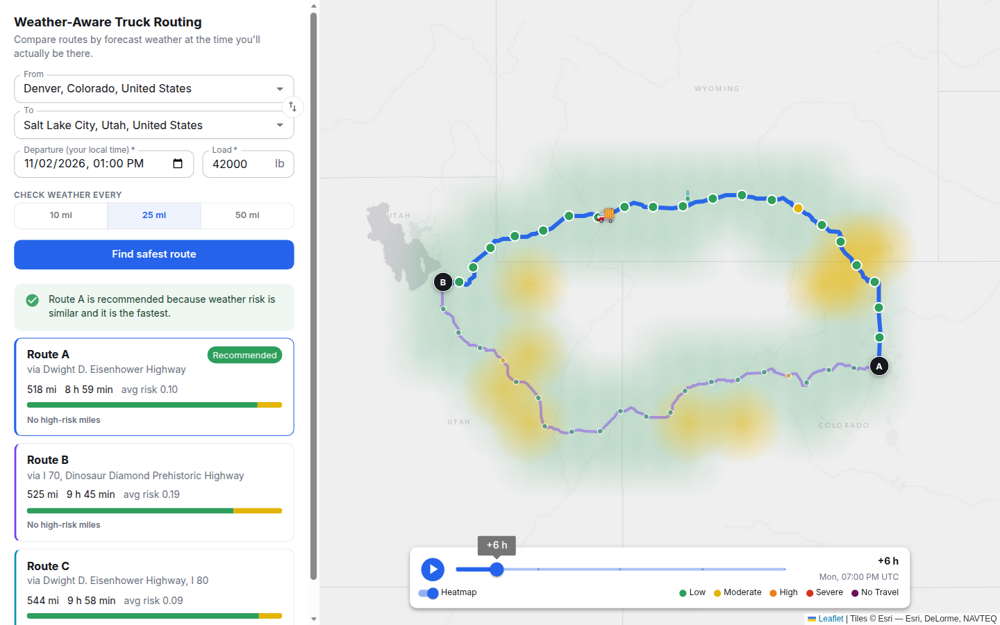

# Weather-Aware Truck Routing

A React + Django app that helps a truck driver pick the safest route. You enter where you're going, when you leave and how heavy the load is. The app compares three routes using the forecast at each point **at the time the truck will actually be there**.

- **Live demo:** _TODO: add the hosted link_
- **Walkthrough video:** _TODO: add the Loom link_

 <!-- TODO: add a screenshot -->

---

## What it does

1. Geocodes the origin and destination (with autocomplete).
2. Gets **3 route options** from a routing API.
3. Drops a **checkpoint every 10, 25 or 50 miles** along each route (you choose) and works out the truck's ETA at each one.
4. Looks up the **hourly forecast at each checkpoint for its ETA hour**, not the departure hour.
5. Classifies each checkpoint with the **risk table and load rules** from the brief.
6. **Recommends a route** using the brief's priority order.
7. Shows everything on a map: route lines, coloured checkpoints with popups (ETA, wind, rain, snow, risk and why), plus route summary cards.
8. Shows a **weather-risk heatmap around the trip corridor** with a **0–48 h slider** (and a play button). A truck icon shows where you'd be at that hour on the selected route.

## Running it locally

You need Python 3.11+ and Node 20+. No API keys: every external service used is free and key-less.

```bash
# backend
cd backend
python3 -m venv .venv
.venv/bin/pip install -r requirements.txt
.venv/bin/python manage.py runserver        # http://127.0.0.1:8000

# frontend (second terminal)
cd frontend
npm install
npm run dev                                 # http://localhost:5173 (proxies /api to :8000)
```

Tests:

```bash
cd backend && .venv/bin/pytest
```

## Architecture

```
frontend/ (React + TypeScript + Vite + Leaflet)
  App.tsx                  page state: plan, selected route, slider hour
  components/TripForm      inputs + validation
  components/PlaceInput    debounced autocomplete
  components/RouteList     route cards + recommendation reason
  components/MapView       routes, checkpoints, popups, truck marker
  components/HeatmapLayer  custom canvas layer for the risk heatmap
  components/HourSlider    0-48 h slider + legend

backend/ (Django, no database models)
  routing/risk.py      risk table, load rules, route summary, ranking   <- pure python
  routing/geo.py       distances, checkpoint sampling, heatmap grid     <- pure python
  routing/clients.py   Photon (geocoding), OSRM (routing), Open-Meteo (weather)
  routing/planner.py   glues it together: routes -> checkpoints -> weather -> risk
  routing/views.py     input validation + JSON endpoints
```

There's one main endpoint, `POST /api/plan`, which returns everything the UI needs in one response: routes, checkpoints, summaries, recommendation and heatmap data for all 49 hours. After that, **the slider never calls the server again**, which is why scrubbing is instant.

In production Django also serves the built React files (WhiteNoise), so it's **one service to deploy** (see `Dockerfile`).

### External APIs

| What      | Service                  | Why                                                                 |
|-----------|--------------------------|---------------------------------------------------------------------|
| Geocoding | Photon (komoot)          | Free, no key, and its policy allows autocomplete (Nominatim's doesn't) |
| Routing   | OSRM public demo server  | Free, no key, returns per-segment durations                         |
| Weather   | Open-Meteo               | Free, no key, hourly forecast, many locations in one request        |

All base URLs are in `settings.py`, so swapping a provider means changing an env var.

## How the logic works

### Checkpoints and ETAs
- OSRM returns the full route geometry plus the travel time of every small segment.
- Truck speed correction: OSRM's public server only has a **car** profile, so no segment is allowed to go faster than **65 mph** (`geo.TRUCK_MAX_MPH`). This is rough, but it stops the ETAs from being car-optimistic.
- We walk along the geometry and drop a checkpoint every N miles, interpolating both position and time inside the segment. The destination is always the last checkpoint.
- ETA = departure + cumulative time to that checkpoint. We use the forecast hour **closest** to the ETA.

### Risk per checkpoint (`risk.py`)
- Wind, rain and snow are each classified with the table from the brief. The **worst one wins**.
- **Shared edges** (e.g. rain 0.25 appears in both Moderate and High): we go **upwards**, so a value on a boundary belongs to the higher band. For rain and snow, "No Travel" is strictly `>` as written (1.00 in/hr of rain is still Severe).
- Load rules are applied to wind: 55+ mph means No Travel for any load; 45–54 mph with more than 30,000 lb means No Travel; 35–44 mph with more than 40,000 lb means at least Severe.
- **Rain** = Open-Meteo `rain + showers` (large-scale + convective). **Wind** = sustained 10 m wind. Gusts are shown in the popup but aren't used for classification, because the table says "wind".

### Turning checkpoints into "miles"
The ranking talks about Severe/High *miles*, but we only know the weather at points. Each stretch between two checkpoints gets the **worse of its two ends**. This is deliberately cautious: over-warning a truck driver is cheaper than under-warning them. Average risk is the distance-weighted average of those stretch levels (0 = Low ... 4 = No Travel).

### Recommendation
Routes are sorted by: **No Travel miles** (my addition, see below), then Severe miles, then High miles, then average risk, then travel time. The UI shows a one-line reason for why the winner won.

> The brief doesn't mention No Travel in the ranking. A route with 1 mile of No Travel shouldn't beat a route with 50 Severe miles, so No Travel goes first.

### Getting 3 routes
OSRM often returns only 1–2 alternatives. When that happens we add a via point to the left/right of the straight line between origin and destination and ask again. Results that are near-duplicates (within 2% distance and time) or detours more than 40% longer are dropped. It works, but it's the weakest part of the backend. A provider with real truck alternatives (HERE, TomTom, OpenRouteService `driving-hgv`) would be the first upgrade.

### Heatmap
- A grid of points is laid over the bounding box of all routes, keeping only points within ~40 miles of a route. Spacing grows on long trips so we stay under ~220 points.
- We fetch hourly weather for those points in the **same** batched Open-Meteo calls as the checkpoints, classify every point for every hour 0–48 (using the load too), and send them as small ints.
- The frontend draws them on **one canvas** as soft radial blobs coloured by level. It's a custom Leaflet layer rather than `leaflet.heat`, because heat plugins show *density* (overlapping points add up), whereas this needs a *value* map. Moving the slider only re-colours ~200 blobs, so it repaints in about a millisecond.

## Performance notes
- One request per plan. Weather for all points is batched (100 locations per call) and fetched in parallel threads.
- Upstream responses are cached in memory for 10 minutes, so re-planning the same trip is fast.
- Display geometry is thinned to one point per ~0.15 mi (the maths still uses the full geometry). JSON is gzipped.
- Leaflet uses `preferCanvas`, so hundreds of checkpoints don't become hundreds of SVG nodes.
- Typical plan: ~5 s cold (mostly waiting on OSRM + Open-Meteo), under 1 s when cached.

## Assumptions and limitations
- **Forecast horizon:** departures must be within 10 days. Forecast skill drops a lot after ~3 days anyway.
- **Not a truck router:** no bridge heights, weight limits or hazmat restrictions. The brief says this isn't needed.
- **Free public APIs** have rate limits. For real use you'd self-host OSRM or use a paid provider.
- **"10 / 25 / 50 miles"** is read as a user choice, not three sampling rates at once.
- No auth, no database. Nothing is stored.

## What I'd do next
- Real truck-profile routing with proper alternatives.
- Use gusts for high-profile vehicles, plus visibility, ice and freezing rain.
- A "leave later" suggestion: re-run the plan for departure +2 h, +4 h... and show if waiting is safer.
- Streaming or progress for the ~5 s plan request.
- Frontend tests (Vitest + React Testing Library) and an end-to-end test with Playwright.

## Deploying
The `Dockerfile` builds the frontend and serves everything with gunicorn. `render.yaml` deploys it on Render's free plan (Docker runtime). Set `DJANGO_SECRET_KEY` and `DJANGO_ALLOWED_HOSTS`.
